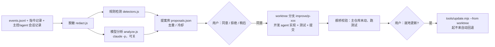

# 功能说明

## 功能清单

| 功能 | 模块 | 状态 | 说明 |
|---|---|---|---|
| 额度条 | 指挥中心顶栏 / 小窗 | 完成 | 按接口 `limits` 列表显示已用 % 和重置倒计时 |
| 部队（会话卡片） | 指挥中心 · UNITS | 完成 | 状态、负载、子 agent、git，按窗口宽度自动排列 |
| 活动终端 | 指挥中心 · AGENTS | 完成 | 所有我方终端，单个打开或全部打开 |
| 通讯记录 | 指挥中心 · COMMS | 完成 | 状态变化事件，持久化 |
| 存档 | 指挥中心 · ARCHIVE | 完成 | 按文件夹分组的历史会话 |
| 我方 agent / 出击 | 指挥中心 | 完成 | 内嵌终端里启动真实 claude |
| 分屏 / 弹出窗口 | 终端面板 | 完成 | 最多 4 分屏，⧉ 弹出 |
| 总指令台 | 指挥中心左侧 | 完成 | 消息框 + 输入框，广播或 `@` 指定 |
| 全军出击 | 指挥中心 | 完成 | 最近 4 个项目最新会话 |
| 恢复阵容 | 后端 | 完成 | 重启 / 升级 / 崩溃后接回 agent |
| 战况小窗 | 桌面 | 完成 | 置顶、可折叠、主题菜单 |
| 授权提醒 | hook + 后端 | 完成 | 会话弹出权限确认时最高优先级提醒 |
| 语言切换 | 指挥中心顶栏 🌐 | 完成 | 中文 / English / 日本語，所有窗口与服务端提醒同步 |
| PR / CI 状态 | — | 未做 | 需要 `gh` 登录，见 T-001 |

## 额度

- 数据来自 `api.anthropic.com/api/oauth/usage` 的 `limits` 列表：`session`（5 小时）、`weekly_all`（本周所有模型）、`weekly_scoped`（按模型，如 Fable）。新出现的额度项会自动显示。
- 显示**已用**百分比（和 `/usage` 一致）；当前起限制作用的一项标橙色，剩余 ≤ 10% 标红。
- 每个额度只显示**已用百分比**和**什么时候重置**：本地时间带日期，如「今天 18:20 重置」「明天 09:00 重置」「11/9 14:00 重置」；最后一小时先倒数，如「还有 25 分钟 · 13:10 重置」。悬停提示也只有这两项。
  - 写法统一在 `web/quotafmt.js`（页面）和 `server/quotatext.js`（通知）。
  - 顶栏每个额度框下面始终显示重置时间；窗口窄（≤ 1500px）时只是收起滚动的倒计时，以前这时连重置时间也一起隐藏了。不做用完预测（0.9.24 起去掉；以前按消耗速度外推的「约 ×× 用完」容易误导）。
- 测试实例请设 `MONITOR_USAGE=off`：额度接口按账号限流，多开实例一起轮询会让正式程序只能显示旧缓存（小窗与指挥中心都会标「缓存 HH:MM」）。
- **额度的第二个来源：我方 agent 的状态栏**。Claude Code 每次刷新状态栏都会把当前额度（`rate_limits`：5 小时、本周）传给状态栏命令；我方 agent 的状态栏是一个什么都不显示的小脚本（`~/.claude-ops/statusline.cmd` → `statusline.cjs`，用本程序自身以 Node 模式运行），把这份额度存到 `statusline-usage.json`。比接口读数新时就用它：只要有我方 agent 在干活，额度就是最新的，且不受接口限流影响。按模型的周额度（如 Fable）不在其中，仍取接口最后一次的值。状态栏在 Windows 上可能由 PowerShell 执行，所以命令只写 .cmd 路径。
- 接口被限流时显示最后一次缓存，并按 2、4、8…最长 30 分钟退避（见 I-001）。
- **每个终端所用模型的额度**（`server/modelquota.js`）：按终端最后用的模型（会话记录里的 `model`）挑出它受限的额度项——不分模型的（5 小时、本周所有模型）加上这个模型自己的周额度（`weekly_scoped:<显示名>`，显示名规整后与模型 id 匹配，如 `Fable` ↔ `claude-fable-5-2[1m]`、`Opus 5.5` ↔ `claude-opus-5-5`）。其中**卡得最紧的一项**显示出来：当前起限制作用（`active`）的优先，其次已用最多的，同分时取模型自己的那项。
  - 指挥中心终端卡片：「记忆负载 / 僚机」下面一整行「额度 · 本周 · Fable　71% · 倒计时」+ 分段条，条下**逐项列出该模型受限的每个额度**，如「5 小时 69% · 还有 25 分钟 · 13:10 重置」「本周 · 所有模型 45% · 11/23 13:00 重置」，起作用的那项在前并高亮；颜色同顶栏（起作用橙、剩 ≤ 10% 红）；悬停列出该模型受限的所有额度项。离线卡片不显示。
  - 手机页部队列表：项目名后一个小标签「Fable · 周 71% · 明天 09:00 重置」。
  - `fleet_status`：每个我方 agent 多一行 `model: <id> · quota <名称> N% used (gating now), resets <时间>`，主控可据此回答「这个终端还能跑多久」。
  - 终端属于另一个组织（按登录时间线，见 `accounts.js`）时用那个组织最后一次的读数，并注明「截至 …」；那个组织没有读数时不显示。

- **主控面板**：「主控在线」旁显示当前读数里最紧的额度和重置时间，如「本周 · Fable 71% · 明天 09:00 重置」。最紧的定义是正在限制的那项，没有就取用得最多的；悬停列出所有额度。
- **额度用完的通知**：
  - 桌面、手机和推送的「额度用完」标题带重置时间，如「「组织」额度用完，今天 18:10 重置」，按额度读数里正在限制的那项计算；没有读数时才用错误原文里的「resets 6pm」。
  - 主控的【舰桥通知】⛔ 额度到限写明「额度重置：5 小时 · 今天 18:10 重置」。

## 部队与状态

- **部队页列出所有项目**：先是正在运行的会话（作战中 / 待命 / 等你授权），后面是没有运行的项目，每个项目一张卡、用它最新的会话，按最后活动时间倒序（最多 16 个；跳过 `AppData` 临时目录和用户主目录）。
- 未运行的卡片标 `OFFLINE · 未出击`，样式同运行中的卡片：负载、模型、最后汇报（没有就显示最后指令）、仓库与推送目标；计时器是距最后一次活动的时间。按钮「▶ 出击」在指挥中心里继续这个会话，「外部终端」在 Windows Terminal 里继续。
- 未运行项目的 git 每 2 分钟扫描一次（运行中的仍是 30 秒），控制开销。

| 状态 | 判定 | 颜色 |
|---|---|---|
| 作战中 | 状态文件 `status = busy` | 青 |
| 待命（做完了，等你指令） | `idle`，且空闲不超过 30 分钟 | 橙 |
| 休眠 | `idle` 超过 30 分钟 | 灰 |
| 等你授权 | 收到授权 hook 通知，且会话还没继续往下走 | 红（闪烁） |

- **记忆负载** = 最后一条 assistant 消息的 input + cache_read + cache_creation token；窗口大小按模型推断（opus-5 系列 1M，其余 200K），≥ 85% 标红。
- **git**：会话目录下 2 层内的每个仓库：分支、上游、↑↓、未提交文件数与增删行、最早改动搁置时长、stash、merge/rebase 中途、Claude 最后改动时间。
- **远程仓库（推送目标）**：每个仓库显示 `git push` 会推到哪里——上游分支所属的远程，没有上游时用 `origin`，只有一个远程时用它。显示为 `origin  github.com/owner/repo`，点击打开仓库页面；有多个远程时标出「另有 upstream」，没有远程时橙色提示「只在本地」。URL 里带的用户名 / 令牌在后端就去掉，不会显示。
- **审查改动**：有未提交改动或未推送提交的仓库行上有「审查改动」按钮，打开审查窗口：顶部是推送目标（远程名、仓库地址、领先几个提交），左侧改动文件（状态、增删行数），右侧该文件相对 HEAD 的彩色差异（新文件对空）；底部写提交说明后「提交」（`git add -A` + `git commit`）、「提交并推送」或单独「推送」（没有上游时推到 origin 并设上游）。后端只接受 git 采集已发现的仓库路径（`/api/git/changes|diff|commit|push`）。
- **终端标题栏的仓库标签**：`⎇ owner/repo · 分支`，取 Claude 最后改动的仓库（文件夹下只有一个仓库时就是它），悬停列出该文件夹下所有仓库的远程。
- 外部终端里的会话只能监控和「跳过去」（把它的终端窗口切到前台）。

## 活动终端（AGENTS）

- 第二个标签：列出所有正在运行的我方终端，每行显示状态（作战中 / 待命 / 等你授权 / 启动中）、项目、名字、最后汇报、记忆负载，以及是否已在分屏里。
- 每行「▶ 打开」把它加入分屏并切过去（已在分屏的显示「切过去」）；顶部「⧉ 全部打开」一次打开全部（分屏最多 4 个，多出的会提示）。
- 顶部「■ 全部结束」：确认后让所有我方终端退出（会话记录保留，可在部队页或存档里继续）。只收起不结束用终端区顶栏的「✕ 全部收起」。
- 原来的「任务」页已去掉：各类提醒（授权、做完了、负载、git、额度）都在总指令台的消息框里，可跳转、稍后、直接回应授权。

## 我方 agent

- **出击（N）**：选文件夹。该文件夹有历史会话时**默认继续最新会话**；也可以选「开新会话」并起呼号、写首个指令（启动后自动发送）。最新会话正在外部终端运行时不能接管，自动改为开新会话。
- **全军出击**：取最近活跃的 4 个项目文件夹（跳过主目录和 `AppData` 临时目录），接管各自最新会话并分屏（动态分屏下一个居中、其余在左侧竖排）；在外部终端运行的跳过并顺延。
- **在此继续**：存档里接管已结束的会话。同一会话不会被接管两次（见 I-007）。
- 我方 agent 启动时不显示用户的 claude-hud 状态栏（通过 `--settings` 关掉），负载显示在终端标题栏。
- 我方 agent 用 Claude Code 的 `dark-ansi` 主题启动（同样通过 `--settings`，不影响你自己终端里的主题）：它只用终端的 16 色，`web/terminal.js` 把这 16 色映射成指挥中心的配色（青为主色，琥珀、红、绿，及配套的蓝、紫）；Claude 的品牌强调色（logo 等，ANSI 亮红）映射为青色。正文为柔和的薄荷绿（`#a6e8c0`），次要文字灰绿，强调为带绿的白（手机「看屏幕」同一套）。已在运行的 agent 下次启动时生效。
- 退出程序会结束我方 agent；阵容会被保存，下次启动自动恢复。

### 主控的派单模板（改善提案 P-002）

终端里的 agent 看不到主控和用户的对话。主控说明（`server/master.js` 的 `GUIDE`，写到 `<数据目录>/master/CLAUDE.md`）要求派任务时（`fleet_send`、`fleet_spawn` 的首条指令）按模板写指令：

| 项 | 内容 |
|----|------|
| 【用户原话】 | 用户这次说的话原样引用，不改写、不删减；前后补充过的一并带上 |
| 【目标】 | 要达到的结果，一两句 |
| 【范围】 | 涉及的项目、目录、页面、环境；用户给过的地址、设备、账号、版本号照抄；不要动的部分 |
| 【验收标准】 | 可以检查的完成条件 |
| 【需要用户配合】 | 要用户动手的环节和入口（填验证码、扫码登录等），没有就写「无」 |
| 【汇报格式】 | 结论、改了什么、怎么验证的和结果、还需要用户做什么 |

- 「调查并修复」「排查」类指令，【需要用户配合】不能省：到了要用户动手的那一步，agent 停下来，在汇报里写清入口和要用户做的事。
- 小指令免模板：一句话能说清的（继续、提交、查个状态、装个版本），只带用户原话直接派。
- 写不出目标或验收标准时：能推断的写上并注明「（主控推断）」，关键信息缺失先问用户。
- `fleet_send`、`fleet_spawn` 的工具说明里也有一句同样的要求，用户改过主控说明时仍然生效。
- **生效条件**：主控说明只在主控启动时写入（`refreshGuide`），并且只替换不存在的文件或没改过的旧默认版本（`OLD_GUIDES`）；用户改过的 `CLAUDE.md` 不动，需要自己把模板加进去。正在运行的主控要重新启动（结束后再开）才会读到新说明。
- 以后再改默认说明：把当前的 `GUIDE` 原样留成 `GUIDE_Vn` 并加进 `OLD_GUIDES`，否则旧默认版本不会被替换（`test/guide.test.mjs` 会检查）。

### 主控派的指令：汇报、全文、自动重发

主控派出的指令（`fleet_send`、排队后发出的、`fleet_spawn` 的首条指令）这一轮结束时，舰桥给主控发「【舰桥通知】完成」（`server/turns.js` → `server/master.js` 的 `doneNotice`）。

- **汇报标记块**（`server/report.js`）：舰桥启动的 agent（主控除外）的系统提示里约定，任务的最终汇报写在单独一行 `[[FLEET-REPORT]]` 和 `[[/FLEET-REPORT]]` 之间。舰桥取这一轮里**最后一个**标记块作为汇报，通知里写「汇报：」。
- **没有标记块时**：取这一轮最后一次工具调用之后的全部文字，并且只算 stop hook 之前的。stop hook（如 project-docs）把 agent 拦回去后，它补的那句（「无需更新文档」）不再覆盖正式回答；stop hook 之前一句话都没有时，才用 stop hook 之后的回复。transcript 里 stop hook 的反馈是 `isMeta` 的 user 消息，以 `Stop hook feedback:` 开头。桌面和手机通知的摘要（`summary.js` 的 `lastTurn`）也按这个规则取回答。
- **全文落盘**（`server/replies.js`）：每次完成或中断，完整回答写到 `<数据目录>/replies/<agent id>/<yyyymmdd-hhmmss>.md`（含指令、状态、用时），每个 agent 保留最近 50 份。通知后面附「全文：<路径>」。
- **通知里回答的长度**（`server/turns.js` 的 `clip`）：汇报标记块完整放进通知，硬上限 6000 字（`REPORT_MAX`）；没有标记块的回答上限 3000 字（`REPLY_MAX`）。超过上限时保留开头 60% 和结尾 40%，中间写「…（中略 N 字）…」，通知末尾注明「（已截断，全文 N 字，可用 fleet_read_reply 读全文）」。标记块之外的过程文字本来就不进通知。
- **`fleet_read_reply(agent, turn?)`**：返回保存的完整回答，`turn` 0 是最近一次，1 是上一次……；没有保存过时（不是主控派的那一轮），读 transcript 里最后一轮的回答。不受屏幕大小和长度限制（`fleet_read_screen` 只能看到当前屏幕）。
- **指令未送进去时自动重发一次**：发出 25 秒后，agent 仍不是作战中、最后一条指令还是旧的，transcript 里也没有这条指令（user 消息），舰桥就重发一次（`agents.js` 的 `resendOrder`）。
  - 重发前先检查：屏幕上有对话框、或输入框里有别人打的字时，不重发。
  - 指令还停在输入框里时，只补按回车。
  - 输入框没画出来时也不重发，后面每次刷新再试；75 秒内一直没能重发，就报「未执行」并说明原因。
  - 重发后又过 50 秒仍没收到，同样报「未执行」，并说明「已自动重发一次」。
  - 重发后正常做完的，完成通知里会注明「指令第一次没送进去，舰桥已自动重发一次」。

## 自我改善（改善提案）

舰桥根据自己的使用情况提出改进舰桥自身的提案，用户同意后在独立分支开发，再次确认后就地更新。设计见 `docs/self-improve-design.md`，代码在 `server/insights/`。

- **数据**：
  - 事件日志 `events.jsonl`：完成、中断、未执行通知，是否截断，读屏、读全文次数，授权等待时长，自动重发，主控回合中或刚结束时的手动纠正，回答授权。
  - 指令记录 `orders.jsonl`。
  - 主控会话里用户自己说的话（不含【舰桥通知】、hook、命令）。
  - 收到过指令的 agent 的会话记录（末尾 8 MB）：失败的工具调用、stop hook、中断、手动输入。
  - 默认统计最近 14 天，只在本机读。
- **脱敏**（`redact.js`）：凡是要进模型输入、提案文字或证据的内容都先过一遍。
  - 各家 key / token：Anthropic、OpenAI、GitHub、GitLab、Slack、AWS、Google、npm、JWT。
  - 私钥，URL 里的账号密码，Authorization / Cookie 头，`password / token / secret / api_key / session / cookie = 值`，命令行的 `--password` 等。
  - 邮箱、长十六进制串、长随机串、长 base64。
  - 本机的推送 topic 和手机访问令牌（按原值）。
  - 用户目录换成 `~`，用户名换成 `‹redacted:user›`。
- **规则检测**（10 个，超阈值才出提案）：截断后读全文、追问主控、频繁读屏、指令没送进去、同类授权久等、手动纠正、重复指令、工具同样方式失败、频繁中断、stop hook 打断。
- **模型分析**：
  - 默认开，`claude-sonnet-5-5`，不带工具、不保存会话，最多 3 分钟。
  - 输入是脱敏后的统计、规则发现和用户原话样本，约 30k 字以内，并附上已有和已拒绝的提案标题，要求不要重复。
  - 输出的证据必须引用输入里出现过的 ref 或指标，引用不上的证据删掉，没有证据的提案丢弃。
  - 模型失败时用规则提案；关掉 `llm` 就完全不出本机。
- **时机**：
  - 每天 12:30，或上次分析后主控回合满 30 轮。
  - 两次自动分析至少隔 6 小时；额度低、demo、或事件不足 20 条时不跑。
  - 指挥中心「立即分析」、主控的 `fleet_improve_analyze` 可随时手动触发。
- **去重与冷却**：
  - 同一 fingerprint，或标题字符二元组相似度 ≥ 0.6，算同一提案，只更新计数和证据。
  - 拒绝的永不再提；只有指标恶化到拒绝时的 3 倍才再提一次，并附上次拒绝的理由。
  - 「稍后」7 天后回到待决定；已更新的同类 30 天内不提。
- **审批入口**：
  - 指挥中心的「改善 PROPOSALS」标签：数字是待决定 + 待更新的数量。列表按状态分组，点开看详情，按钮随状态变化；同意、更新、回滚、丢弃都要确认，拒绝可写理由。
  - 标签页顶部的开关：自我改善、模型分析、推送到手机，以及「立即分析」「清空事件日志」。
  - 手机页的「改善」标签：列表、详情和同样的按钮（开关只在电脑上）。
  - ntfy 推送默认关，推送内容只有标题。
  - 主控：新提案、开发完成、更新结果都会发【舰桥通知】💡 / 🛠 / ✅。三个工具 `fleet_proposals`、`fleet_decide`、`fleet_improve_analyze`；主控说明和工具说明都写明只有用户明确同意才能 approve 或 install。
- **实施**（`implement.js`，同时只做一个）：
  - 在 FleetBridge 仓库建 `git worktree <数据目录>/improve/P-xxx`，分支 `improve/p-xxx`，基线是主仓库 HEAD；主仓库有未提交改动时会提示基线不含它们。`node_modules` 用目录联接指向主仓库。
  - 开发 agent 以 `--permission-mode acceptEdits` 启动（只自动接受工作目录内的编辑）。它的 settings 在舰桥的基础上加了禁止规则：`git push`、`npm publish`、`update.mjs`、安装包、`git worktree remove`、`git branch -D`、`git reset --hard`，并允许 `npm test`、`git add/commit/diff` 等常用命令免确认。
  - 首条指令包含提案全文和规则：只改 worktree、写测试、更新 project-docs、本地提交、用 `[[FLEET-REPORT]]` 汇报。新文件夹的信任对话框由舰桥自动回答。
  - 回合结束后舰桥自己校验：
    - 主仓库的 `git status` 必须和开始时一样（不一样就是越界或你自己改了，为安全标为失败）。
    - worktree 相对基线必须有改动。
    - 在 worktree 里重新跑测试：`node --test "test/*.test.mjs"`，工作目录是 worktree。用的是 PATH 上的 `node`（和 `npm test`、开发 agent 用的一样），找不到才用舰桥自己的可执行文件当 node。结果记下用的 node 版本、通过 / 失败数、失败的测试名和错误信息。
  - 改到 `desktop/`、`bin/`、`package-lock.json` 或 `package.json` 的依赖、外壳字段时，标为「需安装包」，不提供就地更新。
  - 4 小时没做完自动停止，标为失败。
  - **重试**：首条指令开头加一段「这是重试」，写上上一次没通过的原因、验收测试的结果（node 版本、失败的测试、错误信息）、上一次改过的文件，以及你在「重试」时写的备注（要求照做）。
  - 仓库的 `.gitattributes` 让 `docs/project-docs/**` 始终以 LF 入库。pdoc 在 Windows 上写的 CRLF 不会再让整个 entries.json / index.html 都显示为改动。
- **更新与回滚**：
  - 用户确认后，以分离进程运行 worktree 里的 `tools/update.mjs --from <worktree> --data-dir <数据目录> --port <端口>`，输出写进日志，之后每次刷新读一次。
  - `✔ now running` 记为已更新；`✖` 或 5 分钟没结果记为失败（update.mjs 本身会在新版本起不来时回到旧版本）。
  - 「回滚」用主仓库的 `update.mjs --rollback`；「丢弃」先拆掉 `node_modules` 联接（拆不掉就什么都不删），再删 worktree 和分支。
  - 整个流程不 push、不发版；分支保留，合并由用户决定。

## 手机访问

- 顶栏手机图标 → 「开启手机访问」：另开一个只给手机的服务（端口 = 主端口 + 2，安装版为 8789），监听局域网；电脑上的主服务仍只在 127.0.0.1。默认关闭，设置存 `~/.claude-ops/mobile.json`。
- **配对**：对话框里的二维码带一次性密钥，手机扫码后得到有效期 1 年的 HttpOnly Cookie，之后直接打开 `http://<电脑IP>:8789/m`。没有 Cookie 的请求一律拒绝（401），错误密钥 403。「重新生成密钥」让所有已配对的手机失效。装了 Tailscale 时也会列出 Tailscale 地址，可在外面用。
- **手机页面**（`web/m.html`）：额度（已用 %、重置时间）、部队列表（我方终端在前，舰桥外的会话只看状态），点我方终端进全屏终端：看屏幕（1.5 秒刷新）、对话框选项大按钮、常用键（Esc ↑ ↓ 1 2 3 Tab ⏎）、输入框；没有消息页和统一输入框（0.9.21 起）。
- **看屏幕**：彩色显示（后台 `server/screenhtml.js` 按终端同一套配色把屏幕转成 HTML），代码、差异的颜色与电脑上一致。屏幕上有编号菜单（选择题、模型选择等，以当前项光标 ❯ 或 > 识别）时，下方列出为按钮，点一下即选；标题栏有 Esc 按钮可打断。其他输入直接在底部输入框里打字发送。
- **能做的只有**：看状态、看屏幕、发指令 / 排队、回应授权与菜单、Esc。不能启动或结束 agent、不能提交代码、不能改设置。
- 局域网内是明文 HTTP：在公共 Wi-Fi 上不要开；在外面用请走 Tailscale（加密）。首次开启时 Windows 防火墙会询问，需允许「专用网络」。

## 手机推送（ntfy）

- 目的：不看屏幕也知道该做什么。手机装 ntfy（安卓：Google Play / F-Droid，免费），在「手机访问」对话框里开启「推送通知」，扫码订阅（二维码是 `ntfy://ntfy.sh/<频道>` 深链接，扫后直接在 App 里订阅）。
- 推送什么：等你授权（立即，最高优先级）、做完了（空闲满 20 秒）、额度告急、记忆负载过高（每会话每小时最多一次）；启动时已经在等的不推。无论指挥中心是否开着都推。
- 推送内容只有「哪个项目、什么事」，不带命令、代码或回复；消息经过 ntfy.sh 服务器。频道名是随机长串（`~/.claude-ops/push.json`），「换一个频道」可作废旧订阅。手机访问开着时，点通知直接打开手机页。
- 实现：`server/push.js`，按 ntfy 的 JSON 发布格式 POST 到 `https://ntfy.sh`；`/api/push`（开关、换频道）、`/api/push/test`。

## 全文搜索

- 标签栏右侧的搜索框：在所有历史会话（存档里的最近 300 个）中搜你写的指令和 Claude 的回复（不搜工具输出），回车后在存档页显示结果：每个会话最多两段命中片段（标出 YOU / CLAUDE，关键词高亮），可以直接「在此继续」。点左侧文件夹、按 Esc 或 ✕ 退出搜索。
- 实现：`server/search.js` 在 worker 线程里扫描会话记录（约 500 MB 需 2–3 秒，不阻塞推送），`GET /api/search?q=`。

## 终端面板

- 部队卡片「▶ 终端」、小窗点击我方行、存档「▶ 终端」都会把终端加入分屏，最多 4 个，满了替换当前（青框）那一个。
- 顶栏列出未打开的我方 agent，一键加入。
- **动态分屏**（顶栏「⇔ 动态」，默认开，记在本机）：当前终端（点击或输入的那个）在左边占满整个高度、约 3/4 宽；其他终端在右侧一列从上到下排列（按打开顺序），字号略小、稍暗。总指令台只发给一个 agent（含 `@` 单个）时，它自动成为当前终端；发给多个时它们的边框闪一下。关掉后恢复等分，按钮显示「▦ 等分」（开着时显示「⇔ 动态」），一眼能看出当前模式。终端在动画结束后才重新计算尺寸，避免 Claude 反复重绘。
- 每个终端标题栏：名字、状态、负载条与 token、Esc、⧉ 弹出、结束、收起。
- 标题栏在名字旁用橙色显示**项目文件夹名**；没有起呼号的 agent 直接以项目名作名字。动态分屏左侧的小终端只保留名字、项目、状态和收起按钮，保证名字看得清；悬停显示完整路径。

### 拖入文件（0.9.79）

- 把文件（文档、图片等）或文件夹从资源管理器拖进来，**只插入它们的完整路径**，不上传、不复制内容；终端里的 Claude Code 自己去读。拖到哪里，路径就进哪里，拖动时目标显示虚线高亮：
  - **终端面板**（分屏里的 agent、主控、⧉ 弹出窗口）：路径以粘贴的方式写到该终端的输入行，后面带一个空格，**不回车**。
  - **总指令台的输入框**、出击对话框的「首个指令」：插入到光标处，和前后文字用空格隔开。
- 路径里有空格时加双引号；一次拖入多个，用空格分隔。
- 路径由桌面外壳的 preload 提供（`opsBridge.pathForFile` → Electron `webUtils.getPathForFile`，新版 Electron 已去掉 `File.path`）。以下情况不会插入任何内容，而是在页面底部显示提示，不会静默失败：
  - 用浏览器访问舰桥，拿不到本地路径；
  - 外壳早于 0.9.79，preload 里还没有这个接口，提示安装新安装包；
  - 拖进来的不是本地文件，例如从网页拖来的图片。
- 只处理带文件的拖动（`dataTransfer.types` 含 `Files`）。选中文字、粘贴、滚动和拖动面板都不受影响。文件拖到页面其他地方时不会再让窗口打开这个文件、把页面换掉，而是提示拖到终端或输入框。
- 实现见 `web/filedrop.js`（各页共用，`web/terminal.js` 给每个终端接上，`web/app.js` 给输入框接上），`desktop/preload.cjs`（`pathForFile`），`desktop/main.cjs`（弹出窗口也加载 preload）。

## 总指令台

- 位于指挥中心最左侧。
- **顶部是今日概况**（4 格）：今日 token（含输出量、涉及会话数，悬停看输入 / 缓存读写 / 输出明细）、缓存命中率（≥80% 绿、≥50% 橙）、今日指令数（你输入的，不含工具结果和斜杠命令）、等你的会话数（待命未休眠 + 等授权）与最久等待时长。
  - 统计范围：今天（本地 0 点起）写过的所有会话记录，包括已结束的会话和子 agent；同一条回复的多行记录按消息 id 去重。每 30 秒更新。
- **上方是消息框**：所有提醒（等你授权、做完了、负载过高、git…）以消息形式列出，最急的在最上面；每条带「▶ 跳到终端」「稍后」。点一条选中它，Enter 跳转、Space 下一条、S 稍后。发出的指令以右侧气泡显示在「已发送」下面。
- 每条消息占满消息框宽度；提醒消息标题栏右侧显示发生时间（超过一天带日期，悬停看完整时间）。
- **下方是输入框和发送**：`Ctrl+Enter` 发送。写 `@名字` 只发给被点名的 agent（`@` 后可写前缀或项目文件夹名，打 `@` 有补全），不写 `@` 就发给全部我方 agent。
- 发给忙碌中的 agent 时，Claude Code 会排队，做完当前任务再执行。
- **在消息框里直接回应授权**（我方 agent）：后台用 `@xterm/headless` 保留每个 agent 的屏幕副本，弹出权限对话框时读出要做的事（工具、文件或命令、预览）和编号选项，显示在 PERMIT 消息里，点「1. Yes」等选项或「拒绝（Esc）」直接回应，不用切到终端。只认第一个选项是 Yes 的对话框。即使授权 hook 没触发（hook 失败或被关掉），从屏幕识别到对话框也会产生「等你授权」提醒。外部终端里的会话仍需切过去处理。
- **「是否信任此文件夹」一键回答**（我方 agent）：Claude Code 第一次在一个文件夹里启动时会问是否信任它，选 Yes 才开始工作，选 No 会直接退出。舰桥新开的 agent 停在这里时（这时还没有会话，所以没有 PERMIT 提醒），消息框顶部出现一条 TRUST 消息，写明文件夹和每个选项的后果，按钮是「✓ 信任此文件夹，继续」「✓ 信任，以后这个目录不再问」（只在本机显示）「不信任（Claude Code 会退出，agent 结束）」；同时有几个 agent 在等时多一条「✓ 全部信任」。「我方终端」页里这样的 agent 显示为「等你回答」，行上有「✓ 信任」按钮。按钮按选项的文字回答（服务端在屏幕上找到那一项，把光标移过去再回车），不靠编号，也不受两个选项上下顺序的影响。
- **自动信任的目录**（「Web 访问 · 手机」›「通知总结」页的「文件夹信任」，默认关闭）：打开并填入目录（每行一个完整路径）后，舰桥新开的 agent 在这些目录或其子目录里遇到信任对话框时自动回答「信任」，不再通知；自动回答后 5 秒对话框还在，才照常提醒。只接受绝对路径，不接受盘符根目录；按整段路径比较（`E:\work` 不包含 `E:\work2`），并按真实路径判断（目录联接指到列表外的不算）。只能在装舰桥的电脑上改，主控和其他设备不能改。信任一个文件夹等于允许 Claude Code 按那个文件夹里的设置运行 hook 和 MCP 服务，所以只填自己的工作目录。
- **信任对话框给主控的通知**：几个 agent 同时在等时合并成一条，列出每个 agent 和它的文件夹，写明「信任 = 继续启动；No, exit = Claude Code 退出、agent 结束」，并告诉主控用 `fleet_answer` 的 `choice: "trust"` 回答（不要填 1）。其他通知和 `fleet_status` 里，信任对话框的每个选项后面也带上它的后果。
- 要打断单个 agent，用它终端标题栏的 Esc。
- **⏱ 排队**（输入框下方，开关记在本机）：开着时发出的指令进入各 agent 的队列，agent 每做完一轮、空闲满 5 秒（且没有等授权）就自动发下一条；排队中的指令在消息框「排队中」下列出，可 ✕ 移除。队列存在 `~/.claude-ops/queues.json`，重启后继续。与 Claude Code 自己的排队不同：它会把排队的消息合并成一次，这里是一轮一条。
- **☰ 常用**：保存常用指令（`~/.claude-ops/prompts.json`），点一条填入输入框，「＋ 保存当前输入」添加，✕ 删除。

## 战况小窗

- 置顶，右下角为锚点向上生长；指挥中心显示时自动隐藏。
- 标题栏「—」最小化到托盘（任务栏右下角通知区域）：点托盘图标显示 / 隐藏小窗，右键托盘可打开指挥中心或退出。最小化状态会记住，重启后仍隐藏。
- 额度条、最急的一条任务、所有部队（点一行：我方 → 打开终端，外部 → 切到其窗口）。
- ☰ / 右键：打开指挥中心、静音提醒、回到右下角、开机自动启动（仅安装版）、退出。
- Windows 通知（静音时不弹；指挥中心在屏幕上时不弹，它已经显示了一切）：
  - 「等你授权」：立即通知。
  - 「做完了」：会话空闲满 20 秒才通知，轮次之间的短暂停顿不算。
  - 「负载过高」：每个会话每小时最多一次。

## 语言

- 顶栏的地球按钮：中文 / English / 日本語。选择保存在本机（`localStorage`），小窗、弹出终端跟着切换；同时告诉后台（`POST /api/lang`，存 `~/.claude-ops/settings.json`），提醒、领航员台词、通讯记录、额度名称、错误提示也用同一种语言生成。
- 不翻译的内容：会话里你和 Claude 写的文字（指令、汇报、标题），以及切换前已经写下的通讯记录。
- 实现：前端 `web/i18n.js`，代码里写中文，`L('还有 {0} 个仓库…', n)` 按当前语言的词典（`EN`、`JA`，键都是中文原文）取译文；静态 HTML 在加载时由 `translateDom()` 翻译。后端 `server/i18n.js`，`L('中文', 'English', '日本語')` 就地写三种文本。新加界面文字时，两本词典都要补。

## 窗口

- 指挥中心是无边框窗口，右上角自带按钮：**全屏**（盖住任务栏，按钮图标随状态切换）、最小化、最大化 / 还原、关闭（只是收起，agent 和小窗继续运行）。
- **F11** 随时切换全屏，输入时也有效。

## 快捷键（指挥中心）

界面上不再显示快捷键提示（底栏只在连接断开时出现），快捷键照常可用：

| 键 | 作用 |
|---|---|
| Q / E | 切换标签 |
| ← / → | 翻页；存档页 ↑ / ↓ 切换文件夹 |
| Enter | 跳到当前提醒的终端 |
| Space / S | 下一条提醒 / 稍后提醒 |
| N | 出击 |
| Esc | 收起所有终端 |
