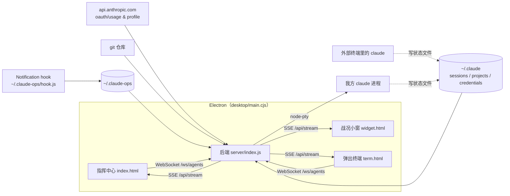

# 架构与模块

## 整体架构

后端在 Electron 主进程内启动（也可 `npm start` 单独运行，此时 Electron 发现端口被占用就直接复用）。所有页面都通过 `http://127.0.0.1:8787` 访问后端。

## 模块说明

| 模块 | 路径 | 职责 | 依赖 |
|---|---|---|---|
| 入口 | `server/index.js` | 定时刷新、组装状态、SSE 推送、REST API、终端 WebSocket、恢复阵容 | 全部 collectors、state、agents、roster |
| 状态 | `server/state.js` | 部队 / 任务 / 事件 / 领航员台词；事件写 `comms.jsonl` | config |
| 额度 | `server/collectors/usage.js` | 读令牌调用 usage / profile；限流退避；本地缓存 | — |
| 会话 | `server/collectors/sessions.js` | 读 `~/.claude/sessions/*.json`，判断进程存活，合并 transcript、子 agent、授权通知 | transcript、notifications |
| 会话记录 | `server/collectors/transcript.js` | 增量读取 `.jsonl`：负载、最后汇报 / 指令、编辑过的文件 | — |
| git | `server/collectors/git.js` | 找仓库、`status --porcelain=v2 -z`、log、diff、stash | git 命令 |
| 存档 | `server/collectors/history.js` | 扫描所有会话记录头尾，取 cwd / 标题 / 最后指令 | — |
| 授权通知 | `server/collectors/notifications.js` | 增量读 hook 写的 `notifications.jsonl` | — |
| 我方 agent | `server/agents.js` | node-pty 启动 `claude`，屏幕缓冲、输入、按 pid 绑定会话 | node-pty |
| 阵容 | `server/roster.js` | 保存 / 读取 `roster.json`；判断孤儿进程 | PowerShell |
| 桌面壳 | `desktop/main.cjs` | 小窗、指挥中心窗口、通知、菜单动作、退出确认 | Electron |
| 指挥中心 | `web/app.js` | 渲染各页、分屏、总指令台、出击 | terminal.js、ui.js |

## 关键设计

- **只读外部状态**：从不刷新 OAuth 令牌，git 用 `GIT_OPTIONAL_LOCKS=0`，不给外部会话写入任何东西（D-001）。
- **授权提醒用 hook**：会话状态文件里没有「等待授权」状态，只能靠 Notification hook（D-002）。
- **指挥中心自己发起 agent**：外部程序无法向运行中的终端会话输入，所以可控制的 agent 必须由我们启动（D-003）。
- **我方 agent 按进程识别**：`/clear`、恢复会话都可能换会话 ID，进程不变（D-004）。
- **数据目录在 `~/.claude-ops`**：安装版程序目录只读；开发版与安装版共用（D-006）。
- **阵容随时保存、启动时恢复**：退出时冻结阵容不被清空，崩溃后靠「父进程已不存在」识别孤儿（见 I-003）。
- **只监听 127.0.0.1**，API 检查 `Origin`，WebSocket 同样校验；接管 / 恢复只接受自己扫描到的会话 ID。
