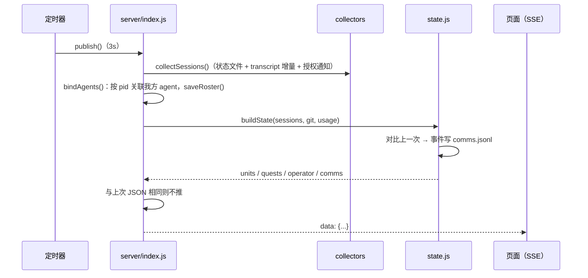
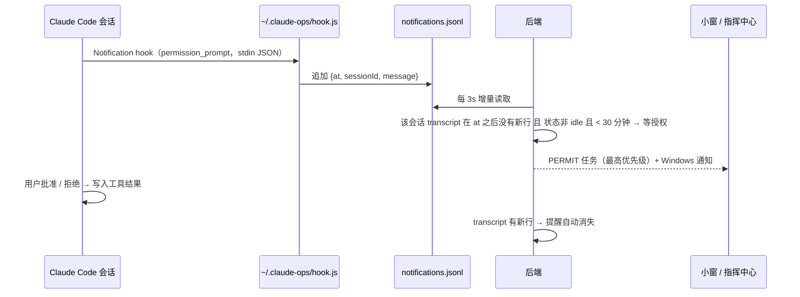
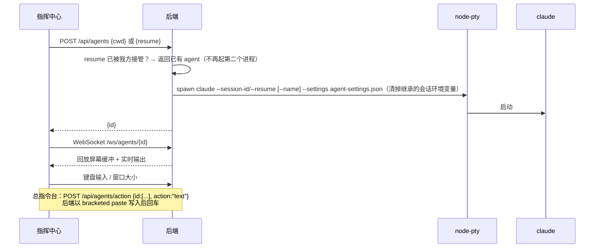
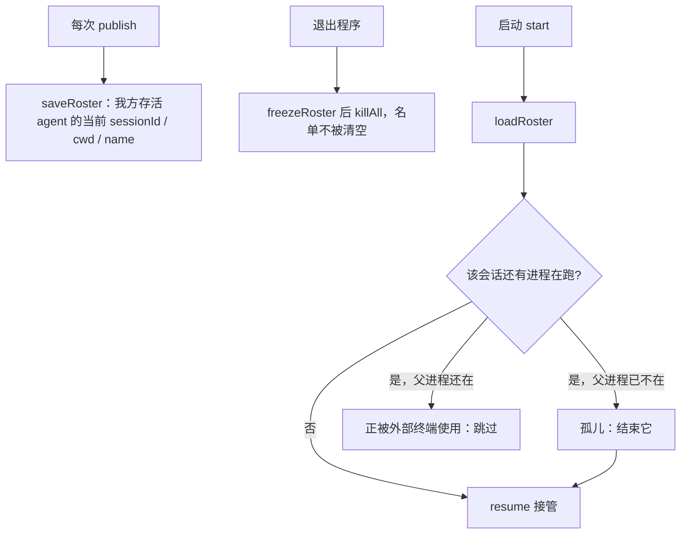

# 核心流程

## 1. 状态刷新与推送

触发：定时器。会话每 3 秒，额度每 3 分钟，git 与存档每 30 秒。

异常分支：
- 额度接口 401 → 显示「登录过期，打开一次 Claude Code」；429 → 退避并显示缓存（I-001）。
- 会话状态文件存在但进程已不在 → 跳过（不显示）。
- 首次刷新不产生事件（避免启动时刷屏）。

## 2. 授权提醒

## 3. 出击 / 接管 / 下指令

## 4. 恢复阵容

## 5. 全军出击

1. 存档按文件夹分组，按最近活动排序。
2. 跳过主目录和 `AppData` 目录；每个文件夹取最新会话：我方 → 直接打开；外部运行中 → 跳过并顺延；否则 → 接管。
3. 主题确认框列出要打开的 4 个，确认后收起现有分屏并依次打开。
