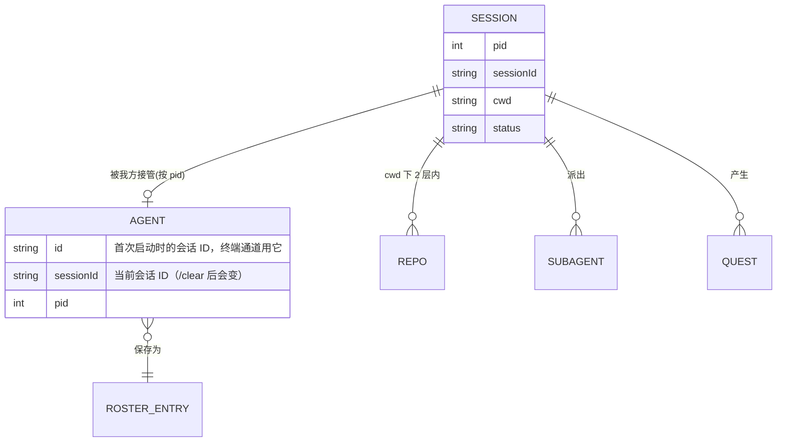

# 数据模型

## 读取的外部数据（只读）

| 来源 | 路径 | 用到的内容 |
|---|---|---|
| 会话状态文件 | `~/.claude/sessions/<pid>.json` | `pid, sessionId, cwd, name, status(busy/idle), statusUpdatedAt, startedAt` |
| 会话记录 | `~/.claude/projects/<cwd 编码>/<sessionId>.jsonl` | assistant `usage`（负载）、`model`、文本、Edit/Write 的 `file_path`、`ai-title`、`last-prompt` |
| 子 agent | `<sessionId>/subagents/*.meta.json` | `agentType, description, finished` |
| 令牌 | `~/.claude/.credentials.json` | `claudeAiOauth.accessToken`、`rateLimitTier`（只读，不刷新） |
| 额度接口 | `GET /api/oauth/usage` | `limits[]`（`kind, percent, resets_at, scope.model, is_active`） |

`cwd 编码`：把路径里所有非字母数字字符换成 `-`，例如 `D:\work\my-app` → `D--work-my-app`。

记忆负载 = `input_tokens + cache_read_input_tokens + cache_creation_input_tokens`，跳过 `model = <synthetic>` 的占位消息（I-008）与 `isSidechain` 消息。

## 程序自己的数据：`~/.claude-ops/`

| 文件 | 格式 | 内容 |
|---|---|---|
| `comms.jsonl` | 每行 `{t, kind, msg, unit}` | 通讯记录（保留最近 200 条） |
| `usage-cache.json` | JSON | 最后一次成功的额度数据 + `retryAt` / `backoffMs` |
| `notifications.jsonl` | 每行 `{at, sessionId, cwd, type, message}` | 授权 hook 写入 |
| `roster.json` | `[{sessionId, cwd, name}]` | 我方阵容（每个会话一条） |
| `hook.js` | 脚本 | 程序启动时从 `server/hook.js` 复制过来 |
| `agent-settings.json` | JSON | 我方 agent 的 `--settings`（关掉状态栏） |
| `config.json` | JSON（可选） | 覆盖默认配置 |
| `replies/<agent id>/<yyyymmdd-hhmmss>.md` | Markdown | 主控派的每个回合的完整回答（每个 agent 保留 50 份），`fleet_read_reply` 读取 |
| `events.jsonl` | 每行 `{at, type, …}` | 自我改善的事件日志：通知（完成 / 中断 / 未执行，含是否截断、回答长度）、读屏、读全文、授权等待时长（信任对话框记为 `permit.wait` 的 `kind: trust`，舰桥自动回答的记为 `trust.auto`）、自动重发、手动纠正、回答授权、分析与实施的步骤。只记类型、次数、时长、agent 名和指令开头，不记整段回答；超过约 4 MB 丢掉较早的一半；自我改善关闭时不写 |
| `self-improve.json` | JSON | 自我改善的开关：`enabled`、`llm`（模型分析）、`model`、`hour`/`minute`（每天分析时间）、`minTurns`、`days`（统计范围）、`push`、`repo` |
| `trust.json` | `{auto, dirs[]}` | 自动信任的目录（`server/trust.js`）：`auto` 开关（默认 `false`）和目录列表（绝对路径）。舰桥新开的 agent 在其中某个目录或其子目录里遇到「是否信任此文件夹」时自动回答信任 |
| `proposals.json` | `{seq, items[], lastAnalysis}` | 改善提案及其全部状态变化（谁、何时、做了什么）、实施信息（分支、worktree、测试、更新日志路径） |
| `improve/P-xxx/` | git worktree | 提案的开发目录（分支 `improve/p-xxx`），`node_modules` 是指向主仓库的目录联接 |
| `improve/P-xxx.settings.json`、`improve/P-xxx-install-*.log` | JSON / 文本 | 开发 agent 的 settings（含禁止规则）、就地更新 / 回滚的输出 |

Electron 自己的窗口偏好（小窗位置、静音）在 `%APPDATA%/<应用名>/widget.json`。

## 核心对象关系

