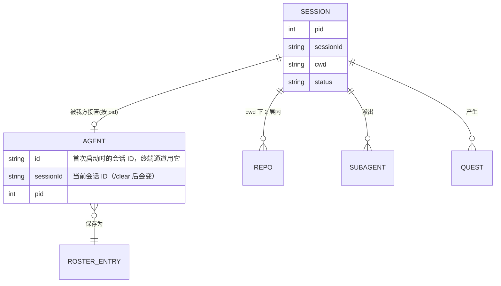

# 数据模型

## 读取的外部数据（只读）

| 来源 | 路径 | 用到的内容 |
|---|---|---|
| 会话状态文件 | `~/.claude/sessions/<pid>.json` | `pid, sessionId, cwd, name, status(busy/idle), statusUpdatedAt, startedAt` |
| 会话记录 | `~/.claude/projects/<cwd 编码>/<sessionId>.jsonl` | assistant `usage`（负载）、`model`、文本、Edit/Write 的 `file_path`、`ai-title`、`last-prompt` |
| 子 agent | `<sessionId>/subagents/*.meta.json` | `agentType, description, finished` |
| 令牌 | `~/.claude/.credentials.json` | `claudeAiOauth.accessToken`、`rateLimitTier`（只读，不刷新） |
| 额度接口 | `GET /api/oauth/usage` | `limits[]`（`kind, percent, resets_at, scope.model, is_active`） |

`cwd 编码`：把路径里所有非字母数字字符换成 `-`，例如 `D:\work\my-app` → `D--work-my-app`。

记忆负载 = `input_tokens + cache_read_input_tokens + cache_creation_input_tokens`，跳过 `model = <synthetic>` 的占位消息（I-008）与 `isSidechain` 消息。

## 程序自己的数据：`~/.claude-ops/`

| 文件 | 格式 | 内容 |
|---|---|---|
| `comms.jsonl` | 每行 `{t, kind, msg, unit}` | 通讯记录（保留最近 200 条） |
| `usage-cache.json` | JSON | 最后一次成功的额度数据 + `retryAt` / `backoffMs` |
| `notifications.jsonl` | 每行 `{at, sessionId, cwd, type, message}` | 授权 hook 写入 |
| `roster.json` | `[{sessionId, cwd, name}]` | 我方阵容（每个会话一条） |
| `hook.js` | 脚本 | 程序启动时从 `server/hook.js` 复制过来 |
| `agent-settings.json` | JSON | 我方 agent 的 `--settings`（关掉状态栏） |
| `config.json` | JSON（可选） | 覆盖默认配置 |

Electron 自己的窗口偏好（小窗位置、静音）在 `%APPDATA%/<应用名>/widget.json`。

## 核心对象关系

