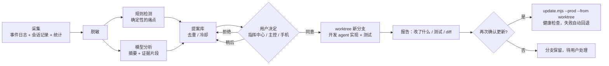
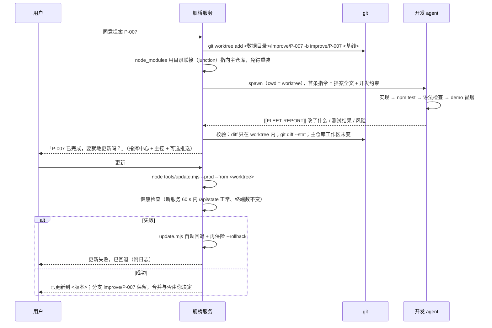

# 舰桥自我改善（改善提案）设计方案

> 状态：**已实现**（2026-11-20，分支 `feat/self-improve`，版本 0.9.74）。阶段 1 与阶段 2 都已完成，包括手机端和推送；阶段 3 未做。5 个确认点都按建议执行：模型分析（脱敏后）默认开，推送默认关，Sonnet，每天 12:30 或满 30 轮。当前行为以 `docs/project-docs/sections/02-features.md` 的「自我改善」一节为准。
> 和下文设计的出入：
> - 会话记录读末尾 8 MB（不是全文）。
> - 自动分析还要求事件 ≥ 20 条，demo 模式不跑。
> - 开发 agent 以 `acceptEdits` 模式启动，并预先允许 `npm test`、`git add/commit` 等常用命令。
> - 回合结束后舰桥会在 worktree 里自己重跑 `npm test`。
> - 「效果复查」（更新后对比指标）还没有单独的界面：已更新的同类 30 天内不再提，30 天后如果检测器的指标仍超标，会作为新提案出现。
> 需求原话：「fleet 会根据用户的使用习惯和会话内容自动提出改善意见，得到同意后会进行开发和更新。」

## 0. 一句话

舰桥每天（或攒够一定轮数后）在本机统计自己的使用数据，先用规则找出明确的痛点，再让模型读脱敏后的摘要和证据片段，写出「改善提案」。提案出现在指挥中心和主控对话里，用户同意后：

1. 舰桥在一个**独立的 git worktree 分支**里派开发 agent 实现、测试、验证，然后报告。
2. 用户**再次确认**后，才用 `tools/update.mjs --prod --from <worktree>` 就地更新。更新失败会自动回退。
3. 整个过程不 push，不发版，不改其他项目。



---

## 1. 数据来源

全部是本机已有的文件，另外新增一个事件日志。

| 来源 | 位置 | 能看出什么 |
|---|---|---|
| **事件日志（新增）** | `<数据目录>/events.jsonl` | 舰桥自己发生过的事，见下表。这是统计的主要依据，比事后翻 transcript 准 |
| 指令记录 | `orders.jsonl`（已有） | 谁派的（主控 / 输入框 / 手机 / 终端）、派给谁、文本：常用指令、重复派发 |
| 通讯记录 | `comms.jsonl`（已有） | 状态变化：出击、完成、等授权、出错 |
| 通知历史 | `notice-history.json`（已有） | 完成、等授权、中断、未执行 |
| 完整回答 | `replies/<agent>/*.md`（0.9.73 新增） | 回答长度、是否带汇报标记块 |
| 主控会话记录 | 主控 session 的 transcript | 用户对主控说了什么：重复追问（「结果呢」「汇总一下」）、纠正、不满 |
| 各 agent 会话记录 | `~/.claude/projects/**/<session>.jsonl` | 失败的工具调用（`tool_result.is_error`）、被拒的授权、中断、stop hook 次数、用户在终端里手动打的纠正 |

**事件日志要记的事件**（在现有代码对应位置加一行 `logEvent()`）：

| 事件 | 字段 | 埋点位置 |
|---|---|---|
| `notice.done` / `notice.interrupted` / `notice.never_ran` / `notice.error` | agent、用时、回答长度、是否截断（cut）、是否带标记块、是否重发过 | `index.js` 发完成通知处 |
| `order.resent` / `order.blocked` | agent、原因 | `turns.js` |
| `tool.read_screen` / `tool.read_reply` / `tool.send` / `tool.answer` | agent、距上一条完成通知多久 | `index.js` 对应的 API |
| `permit.wait` | agent、工具、命令摘要、等了多久、谁回答的、选了什么 | `prompts` 出现 / 消失时 |
| `order.correction` | agent、主控派的指令结束后多久，用户在终端或输入框里又打了什么 | `noteOrder` 的 `by !== 'master'` 分支，紧跟主控回合时 |
| `quota.low` / `sys.alert` | — | 已有通知处 |

**范围与开关**
- 只统计最近 14 天（可配置）。只读本机文件。
- 设置项 `selfImprove.enabled` 可以整个关掉。关掉后不再写事件日志、不分析，已有提案保留。
- 另有一个 `selfImprove.llm` 单独控制模型分析这一步，见 §2.3 隐私说明。

**脱敏**（新 `server/insights/redact.js`）：凡是进入模型输入、提案文本或证据片段的文字，都先经过它处理。
- 密钥类：`sk-ant-…`、`ghp_/gho_/github_pat_…`、`AKIA…`、`Bearer xxx`、JWT（`eyJ…`）、`-----BEGIN … PRIVATE KEY-----`。
- 赋值类：`password=… / passwd / secret / token / api_key / apikey`（`=` 或 `:` 后面的值）。
- 高熵串：长度 ≥ 24、只含字母和数字的随机串（推送 topic、session cookie 等）。
- 本机特有的值：`push.json` 里的 ntfy topic 原文、`mobile.json` 的令牌。
- 个人信息：邮箱，以及 `C:\Users\<用户名>` 换成 `~`。
- 替换为 `‹已脱敏:类型›`。有单元测试覆盖。

---

## 2. 分析方式

### 2.1 什么时候跑

满足以下任一条件即触发：
- 每天一次（默认 12:30，可改）。
- 上次分析之后，主控派出的回合累计 ≥ 30 轮。
- 用户在提案面板点「立即分析」，或对主控说「分析一下」（主控调用 `fleet_improve_analyze`）。

以下情况不跑：
- 额度低（沿用 `quotaLow()`）。
- 正在跑另一次分析。
- 距上次分析不到 6 小时（手动触发除外）。

### 2.2 第一层：规则检测（确定性，不用模型，不花额度）

`server/insights/detectors.js`。每个检测器输出 `{ fingerprint, metric, value, threshold, evidence[] }`，超过阈值就生成「候选发现」：

| 检测器 | 信号 | 典型提案方向 |
|---|---|---|
| 回答截断后读全文 | `notice.done` 截断 → 10 分钟内 `tool.read_reply` / `read_screen` 的比例 | 调整截断长度，或让汇报更短 |
| 主控反复追问 | 主控会话里用户说「结果呢 / 汇总 / 继续 / 再说一遍」类短句的次数 | 改主控说明或通知格式 |
| 读屏频繁 | 每个回合的 `read_screen` 次数高 | 状态信息不够，加字段 |
| 指令没送进去 | `order.resent` / `never_ran` / `blocked` 次数及原因分布 | 修对应的对话框识别 |
| 授权久等 | `permit.wait` 按「工具 + 命令前缀」聚合：次数多、每次都同意、平均等待长 | 建议加入允许列表（只是提议，不自动改） |
| 中断 | `notice.interrupted` 多的 agent / 指令类型 | — |
| 工具调用失败 | transcript 里 `is_error` 按工具 + 错误开头聚合 | 环境问题（如 Windows 路径、编码）给 agent 加提示 |
| 用户手动纠正 | `order.correction`：主控回合刚结束，用户就在终端里补指令 | 主控派单不够清楚，改指令模板 |
| 重复指令 | 相似指令（去空白后前 40 字相同）一周内派发 ≥ 3 次 | 做成快捷指令或 skill |
| stop hook 打断 | 每回合 stop hook 次数 | — |

规则层的输出**本身就可以成为提案**（模板化文字），模型层只是把它们写得更具体，再补上规则看不出来的问题。

### 2.3 第二层：模型分析

**怎么调用**
- 和现有摘要（`summary.js`）一样调用本机的 `claude -p`：不带工具、不保存会话、`--setting-sources ''`、工作目录在临时目录。
- 模型默认用 Sonnet（分析需要一些推理），可在设置里换 Haiku 省额度。

**输入**（全部脱敏后，控制在约 30k 字以内）
1. 第一层的指标摘要和候选发现。
2. 证据片段：每条发现最多 3 段，每段 ≤ 600 字（指令、回答开头、用户的追问或纠正）。
3. 舰桥功能概要：从 `docs/project-docs/sections/02-features.md` 截取的目录级说明，让模型知道已经有什么。
4. **已有提案和已拒绝提案的标题与理由**：要求模型不要重复提，也不要换个说法重提。

**输出**：严格的 JSON 数组。每条提案包含：

```jsonc
{
  "title": "完成通知按汇报标记块显示，截断上限提到 3000 字",
  "finding": "现象：…",                              // 发现的现象
  "evidence": [{ "ref": "notice:2026-11-18 14:02 mdlinkapp", "quote": "…" }, { "metric": "cut_then_read_rate", "value": "62% (31/50)" }],
  "change": "建议改动：…（涉及 server/turns.js REPLY_MAX、master.js doneNotice）",
  "benefit": "预期收益：主控少读一次全文，平均每回合省 1 次工具调用",
  "effort": "S",                                        // S ≤ 半天 / M ≤ 2 天 / L 更多
  "risk": "低：只影响通知文本长度",
  "fingerprint": "notice-cut-length"                    // 规则发现沿用检测器的指纹；模型新提的由它给一个短语义键
}
```

**校验**
- 服务端校验字段是否齐全、`effort` 是否合法。
- 证据里引用的 `ref` 和 `metric` 必须在输入里出现过；对不上的提案丢弃，防止编造证据。

**隐私说明（需要你确认）**：
- 「只在本机分析、不外发」这一条，规则层可以完全做到。
- 模型层用的是你本机的 Claude Code，**脱敏后的摘要和片段会发送到 Anthropic API**。这和你平时各会话的内容走的是同一个服务商，没有其他第三方。
- 如果要求一个字节都不出本机，就把 `selfImprove.llm` 关掉：只有规则层的提案，提案文字是模板化的，也看不出规则覆盖不到的问题。

### 2.4 去重与冷却

提案库位于 `<数据目录>/proposals.json`。

| 情况 | 处理 |
|---|---|
| 同一 `fingerprint` 已有「待决定 / 稍后 / 进行中」的提案 | 不新建，只更新它的证据和计数（「又出现 12 次」） |
| 同一 `fingerprint` 被**拒绝**过 | 永不再提。例外：指标比拒绝时恶化 3 倍以上，才作为「再次出现」提一次，并附上次拒绝的理由 |
| 标题和已有提案高度相似（字符二元组 Jaccard ≥ 0.6） | 当作重复丢弃 |
| 「稍后」 | 7 天后回到「待决定」，或用户手动拉回 |
| 已实施（installed） | 30 天内不再提同类；之后检测器指标没改善，才提「效果复查」 |

---

## 3. 呈现与审批

### 3.1 指挥中心

- 顶栏加入口「💡 改善提案」，有待决定的提案时显示数字角标。也可以放进现有的「指令」标签页里做一个子页，实现时看哪个排版合适。
- **列表**：标题、工作量（S/M/L）、风险、证据数、状态、提出时间。按状态分组：待决定 / 进行中 / 待更新 / 已完成 / 已拒绝。
- **详情**：现象、证据（可展开原始片段，片段已脱敏）、建议改动、收益、工作量、风险。
- **按钮**：
  - 「同意并开发」
  - 「拒绝」：可写理由，理由会进入下次分析的输入。
  - 「稍后（7 天）」
  - 实施后：「查看 diff」「就地更新」「回滚到更新前」「丢弃分支」
- 设置对话框里加「自我改善」页：开关、模型分析开关、频率、模型、是否推送到手机，以及「立即分析」「清空事件日志」两个按钮。

### 3.2 主控

**新增 MCP 工具**
- `fleet_proposals(status?)`：列表或单条详情。
- `fleet_decide(id, decision: approve|reject|later|install|rollback|discard, note?)`：对提案做决定。
- `fleet_improve_analyze()`：立即分析一次。

**新通知**
- 新提案产生后，主控会收到一条批量的【舰桥通知】：「改善提案 N 条：①…②…，用 fleet_proposals 看详情，转告用户并问是否同意」。
- 主控说明（GUIDE）里写明规则：**只有用户明确同意才能调用 `approve` / `install`，主控自己不能替用户同意**。这一条也写进工具说明。

### 3.3 手机

- 手机页加「改善提案」折叠区，有列表和三个按钮。
- ntfy 推送「💡 新的改善提案 N 条」，默认关闭。

---

## 4. 同意之后的流程



**要点**

- **为什么用 worktree，不直接在 `E:\project\FleetBridge` 里开分支**：你自己或其他 agent 可能正在主仓库工作区里改东西（比如现在就有未提交的改动）。worktree 和主仓库工作区完全隔离，切分支、跑测试都不会碰到它们。
- **基线**：默认取主仓库当前 `HEAD`（提交过的代码）。主仓库有未提交改动时，在报告里提示「基线不含你未提交的改动」。
- **开发约束**：写进首条指令，同时由舰桥用 agent 的 `--settings` 强制执行。
  - 只修改当前 worktree 里的文件；不碰其他目录和项目。
  - 不 `git push`、不 `npm publish`、不运行安装包、不运行 `update.mjs`（更新由舰桥在用户确认后做）。
  - 必须补或更新测试，`npm test` 通过；改动要记入 project-docs。
  - 在 worktree 分支上提交（本地 commit）。
  - 最后用 `[[FLEET-REPORT]]` 汇报：改了哪些文件、怎么验证的、风险、怎么回滚。
- **强制手段**：开发 agent 的 settings 里配 `permissions.deny`：`Bash(git push:*)`、`Bash(npm publish:*)`、`Bash(*update.mjs*)`、`Bash(*FleetBridge-Setup*)`。
- **构建**：
  - 就地更新只需要源码树（`update.mjs --from`），所以默认不打安装包。
  - 改动涉及 `desktop/`、依赖（`package.json` 的 dependencies、`node_modules`）或 Electron 时，就地更新不够。`update.mjs` 只在 `fleetShellApi` 升高时才拒绝，所以由舰桥在校验 diff 时检查这几类路径。命中时，提案状态标为「需要安装包」，报告写明「请另行确认」，开发 agent 只执行 `npm run dist`（输出到 worktree 的 `dist/`），不安装，也不提供「就地更新」按钮。
- **完成判定**：沿用 0.9.73 的回合通知。开发 agent 回合结束、并且舰桥校验通过 → 状态 `built`。agent 出错或中断 → 状态 `failed`，附原因，可以「重试」（同一个 worktree 再派一次）。
- **更新后**：分支保留，提案状态变为 `installed`，记录更新前的版本号，用于回滚。
- **合并**：合并到 main 由用户决定。可以对主控说「把 P-007 合并」，主控照常派 agent 去做。

---

## 5. 安全边界

| 边界 | 做法 |
|---|---|
| 只改 FleetBridge 自身 | 开发 agent 的 cwd 是 FleetBridge 的 worktree。完成后舰桥校验：diff 只在 worktree 内，主仓库和其他项目的 `git status` 没变（对比 spawn 前后的快照）。校验不过就标为 `failed`，不允许更新 |
| 不自动 push / 发版 | `permissions.deny` 加上流程里根本没有这一步。push 和发版只能由用户另外下指令 |
| 安装要二次确认 | `install` 只能由用户点按钮或明确对主控说；主控说明和工具说明里都写明 |
| 失败可回退 | `update.mjs` 本身会在新版本起不来时回退。舰桥再做一次健康检查，不通过就执行 `--rollback`。之后任何时候都可以在提案详情里点「回滚到更新前」 |
| 数据不外发 | 只有模型层会把脱敏摘要发给 Anthropic API，可关。推送默认关，推送内容只有标题，不带证据 |
| 变更记录 | 提案库记录每个状态变化（谁、何时、做了什么）；worktree 分支上有提交历史；更新记录在 `<数据目录>/improve/log.jsonl`；改动记入 project-docs（由开发 agent 完成） |
| 资源控制 | 同时最多 1 个开发 agent。分析的 `claude -p` 同时只跑 1 个，额度低时不跑 |
| 承认做不到的 | Claude Code agent 有 Bash，没法在系统层面完全阻止它写别的目录。这里靠三层把关：deny 规则、事后校验、安装前人工确认，不能承诺「技术上不可能越界」 |

**回滚方式汇总**
- 已更新的版本：`node tools/update.mjs --rollback --prod`，或点提案详情里的按钮。
- 不要这个改动了：点「丢弃分支」，执行 `git worktree remove` 和 `git branch -D improve/P-xxx`，并二次确认。
- 整个功能不想要：设置里关闭自我改善，已有数据不删；可以手动删 `events.jsonl` 和 `proposals.json`。

---

## 6. 分阶段与工作量

### 阶段 1（MVP）：能提、能批、能做、能更新

| 内容 | 文件 |
|---|---|
| 事件日志与埋点 | 新增 `server/insights/events.js`；修改 `index.js`、`turns.js`、`agents.js`（少量埋点） |
| 脱敏 | 新增 `server/insights/redact.js` |
| 数据汇总与检测器（先做 6 个：截断后读全文、主控追问、读屏频繁、指令没送进去、授权久等、用户手动纠正） | 新增 `server/insights/collect.js`、`detectors.js` |
| 模型分析与校验 | 新增 `server/insights/analyze.js`（复用 `summary.js` 的 `claude -p` 调用方式，抽出公共函数） |
| 提案库、去重、冷却 | 新增 `server/insights/proposals.js` |
| 实施流程：worktree、spawn、校验、更新、健康检查、回滚 | 新增 `server/insights/implement.js` |
| 接口：`GET /api/proposals`、`POST /api/proposals/decide`、`POST /api/proposals/analyze` | `server/index.js` |
| 主控：3 个工具、批量通知、GUIDE 规则 | `server/fleet-mcp.cjs`、`server/master.js` |
| 指挥中心：入口、列表、详情、按钮；设置页 | 新增 `web/proposals.js`；修改 `web/index.html`、`web/app.js`、`web/style.css`、`web/i18n.js` |
| 测试：脱敏、检测器、去重和冷却、提案状态机、实施流程（用假 git 仓库加假 spawn） | `test/insights-*.test.mjs` |
| 文档 | 功能、API、数据章节，以及决策记录 |

估算：约 1,500–1,900 行（含测试约 400 行），**2–3 个工作日**（agent 连续做，含自测）。

### 阶段 2：更好用

- 手机页提案区和 ntfy 推送。
- 补齐检测器（工具调用失败聚类、重复指令、中断、stop hook）。
- 效果复查：更新后对比该检测器的指标，在提案里显示「改善前 62% → 改善后 18%」。
- 拒绝理由的学习：把理由归类后注入下次分析。

估算约 600–800 行，**1–1.5 天**。

### 阶段 3：可选

- 「提案草稿」：模型先给出改动范围预估（会动哪些文件），让工作量更准。
- 多个提案打包实施。
- 一键合并到 main（仍需确认，且不 push）。

---

## 7. 需要你确认的点

1. **模型分析会把脱敏后的数据发到 Anthropic API**（走本机 Claude Code），可以接受吗？还是只做规则层？我的建议是接受，同时保留开关。
2. **默认开还是关**：建议新功能默认**开**（事件日志 + 每天分析），推送默认关。
3. **分支怎么开**：上一项任务（0.9.73：汇报标记块、`fleet_read_reply`、自动重发）还**没提交**，在 `feat/report-reply-resend` 的工作区里。建议先把它在该分支上**本地提交**，再从它开 `feat/self-improve` 来做本功能。否则新分支会带着这些未提交改动，两份工作混在一起。需要你同意提交（只本地 commit，不 push）。
4. **分析用的模型与频率**：默认 Sonnet、每天一次（12:30）或满 30 轮，可以吗？
5. **MVP 范围**：按 §6 阶段 1 做，可以吗？手机页和推送放到阶段 2。
